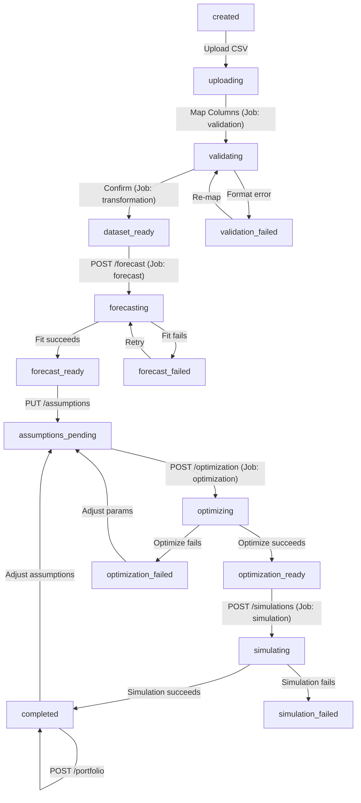

# CLAUDE.md — StockPilot AI Technical Architecture and System Specification

StockPilot AI is a decision-support prototype for demand forecasting, safety stock calculation, discrete-event inventory simulation, and working-capital portfolio allocation. It integrates classical statistical time-series models, gradient-boosted quantile regressions, mathematical programming solvers, and retrieval-augmented conversational AI into an auditable multi-tenant system for inventory planning.

---

## 1. System Purpose and Operating Boundaries

### 1.1 The Operational Problem
Inventory managers balance conflicting operational and financial objectives:
- **Excess Working Capital and Holding Costs**: Over-ordering ties up capital and incurs storage, capital, and shrinkage expenses.
- **Stockouts and Lost Sales**: Under-ordering leads to unfulfilled demand, lost customer orders, and emergency expediting expenses.
- **Demand Uncertainty and Intermittency**: Many SKUs exhibit non-Gaussian patterns (lumpy, intermittent, or erratic sales) where Gaussian safety stock approximations misstate buffering requirements.
- **Stochastic Lead Times**: Supplier replenishment lead times vary stochastically, compounding demand variance during transit.
- **Multi-SKU Portfolio Constraints**: Individual SKU optimizations ignore warehouse footprint limits and working capital budgets.

### 1.2 Solution Strategy
StockPilot AI implements a multi-stage analytical pipeline:
1. **Multi-Model Rolling Evaluation**: Evaluates time-series baselines (AutoETS, Croston SBA, Seasonal Naive, Naive) alongside cross-sectional ML models (Global LightGBM quantile regression) across rolling historical origins to select the model with lowest out-of-sample MASE per SKU.
2. **Three-Tier Policy Synthesis**: Computes analytical deterministic policies ($s_{\text{det}}$), probabilistic quantile spread policies ($s_{\text{quant}}$), and empirical non-parametric bootstrap policies ($s_{\text{emp}}$) incorporating stochastic lead-time demand distributions.
3. **Discrete-Event Monte Carlo Validation**: Simulates all three policies over 500 synthetic replications and historical holdout demand paths to measure fill rates, cycle service levels (CSL), and total costs under identical conditions.
4. **Constrained Portfolio Optimization**: Formulates service-level allocation as a Mixed-Integer Linear Program (MILP) solved via SciPy `milp` to maximize portfolio performance subject to budget and storage capacity constraints, computing shadow prices for marginal capital decisions.
5. **Grounded AI Retrieval**: An AI assistant where numbers are checked against stored session results within a stated tolerance ($\pm 0.1\%$ or $0.005$ absolute) before presentation.

---

## 2. Architectural Topology and Service Boundaries

StockPilot AI consists of four decoupled layers communicating across HTTP and schema boundaries:

```
+------------------------------------------------------------------------------------+
|                                 React 19 Frontend                                  |
|            JavaScript (ESM), Tailwind CSS v4, Redux Toolkit Query, Recharts        |
+------------------------------------------+-----------------------------------------+
                                           | HTTP REST (Firebase JWT Bearer Token)
                                           v
+------------------------------------------------------------------------------------+
|                                Node.js API Gateway                                 |
|            Express 5.3 (ESM JavaScript), MongoDB 6+ Job Queue, LangGraph           |
+---------------------+----------------------------------------+---------------------+
                      | HTTP POST (X-Service-Key)              | Hybrid Vector Search
                      v                                        v
+---------------------------------------------+ +------------------------------------+
|            Python Stats Service             | |        Qdrant Vector Engine        |
|     FastAPI 0.115, Statsforecast 2.1,       | | (Multi-tenant collection filtering |
|     LightGBM 4.7, SciPy 1.17, NumPy 2.2     | |     by userId and sessionId)       |
+---------------------------------------------+ +------------------------------------+
```

### 2.1 Component Responsibilities

#### 1. React 19 Frontend (`client/`)
- Built with Vite 6.4.1, React 19.3.1, Tailwind CSS 4.3.5, and Recharts 3.8.0. Written in JavaScript (ESM).
- State management and API caching via Redux Toolkit 2.11.2 and RTK Query (`client/src/lib/api.js`).
- Structured as a sequential pipeline UI: Dataset Upload $\rightarrow$ Validation $\rightarrow$ Forecast $\rightarrow$ Assumptions $\rightarrow$ Optimization $\rightarrow$ Simulation $\rightarrow$ Portfolio $\rightarrow$ Summary.
- Interactive SKU detail drawer (`client/src/features/optimization/SkuDrawer.jsx`) for drill-down inspections.

#### 2. Node.js API Server (`server/`)
- Express 5.3.0 application running on Node.js 20+ (`server/server.js`, `server/src/app.js`). Written in JavaScript (ESM).
- Enforces multi-tenant data isolation: all user datasets, runs, and sessions are partitioned by `userId` extracted from verified Firebase Admin tokens.
- Manages an in-process, MongoDB-backed asynchronous job runner (`server/src/services/jobRunner.js`) with concurrency control (`JOB_CONCURRENCY=2`), deduplication hashing, cooperative `AbortController` cancellation, and stage progression.
- Validates all input/output boundaries using strict Zod schemas (`server/src/contracts/`).
- Orchestrates conversational AI workflows using LangGraph (`server/src/services/ai/agent.js`) with an append-only `EvidenceLedger`.

#### 3. Python Stats Service (`stats-service/`)
- Stateless computational microservice built on FastAPI 0.115.11 and Python 3.11 (`stats-service/app/main.py`).
- Protected by shared secret authentication via `X-Service-Key` header (`stats-service/app/security.py`).
- Implements numerical algorithms using `numpy` 2.2.6, `scipy` 1.17.1, `pandas` 2.3.3, `statsforecast` 2.1.1, and `lightgbm` 4.7.0.
- Validates all payloads with strict Pydantic v2 schemas (`stats-service/app/schemas.py`).
- Returns raw statistical metrics in `snake_case` JSON, persisted unchanged by the Node.js layer.

#### 4. Vector Database (`Qdrant`)
- Hosts chunked session artifacts, forecasting summaries, policy definitions, and simulation results.
- Payload filtering ensures the conversational AI only retrieves documents matching the active `sessionId` and `userId`.

---

## 3. End-to-End Pipeline Execution Flow

Every user analysis is encapsulated within an isolated Session (`server/src/models/session.model.js`). State progression is enforced by `server/src/services/stateMachine.js`:



### Stage Details

| Stage | Input Data | Job Name | Endpoint | Output Artifact | State Transition |
| :--- | :--- | :--- | :--- | :--- | :--- |
| **1. Dataset Upload** | Raw CSV file | None (streaming) | `POST /api/v1/sessions/:id/dataset` | Raw file in local storage | `created` $\rightarrow$ `uploading` |
| **2. Column Mapping** | Column mapping config | `validation` | `POST /api/v1/sessions/:id/dataset/mapping` | `validationSummary`, `aggregated.json` | `uploading` $\rightarrow$ `validating` |
| **3. Dataset Transformation** | `aggregated.json` | `transformation` | `POST /api/v1/sessions/:id/dataset/confirm` | `processed.csv`, `processedSeries` docs | `validating` $\rightarrow$ `dataset_ready` |
| **4. Forecasting** | Dense daily series | `forecast` | `POST /api/v1/sessions/:id/forecast` | `ForecastRun`, `SkuForecast` records | `dataset_ready` $\rightarrow$ `forecasting` $\rightarrow$ `forecast_ready` |
| **5. Assumptions** | Unit costs, holding rate, lead times, service level | None (sync) | `PUT /api/v1/sessions/:id/assumptions` | `AssumptionsSet` doc | `forecast_ready` $\rightarrow$ `assumptions_pending` |
| **6. Policy Optimization** | Forecasts, residuals, assumptions | `optimization` | `POST /api/v1/sessions/:id/optimization` | `OptimizationRun`, `SkuOptimization` records | `assumptions_pending` $\rightarrow$ `optimizing` $\rightarrow$ `optimization_ready` |
| **7. Simulation** | Policies $(s, Q)$, demand paths | `simulation` | `POST /api/v1/sessions/:id/simulations` | `SimulationRun`, `SkuSimulation` records | `optimization_ready` $\rightarrow$ `simulating` $\rightarrow$ `completed` |
| **8. Replay** | Historical series, assumptions | `replay` | `POST /api/v1/sessions/:id/replay` | `ReplayRun`, `SkuReplay` records | Remains in current state |
| **9. Portfolio MILP** | SKU sweep curves, budget, capacity | None (sync via Python) | `POST /api/v1/sessions/:id/portfolio` | `PortfolioPlanSummary`, shadow prices | `completed` |
| **10. Grounded AI** | Chat message, session context | None (SSE stream) | `POST /api/v1/sessions/:id/ai/chat` | Streaming message, evidence citations | `aiEligible` |

---

## 4. Technical Stack Inventory

| Layer | Component | Version | Key Packages | Language |
| :--- | :--- | :--- | :--- | :--- |
| **Frontend** | Application Framework | 19.3.1 | `react`, `react-dom`, `react-router-dom@7.18.5` | JavaScript (ESM) |
| | Build Tool | 6.4.1 | `vite`, `@vitejs/plugin-react` | JavaScript |
| | State & Data Fetching | 2.11.2 | `@reduxjs/toolkit`, `react-redux`, `axios@1.15.0` | JavaScript |
| | Styling & UI | 4.3.5 | `tailwindcss`, `lucide-react@1.16.0`, `recharts@3.8.0` | JavaScript / CSS |
| **Backend** | Runtime & Server | Node.js 20+ / Express 5.3.0 | `express`, `cors`, `helmet`, `morgan`, `multer` | JavaScript (ESM) |
| | Database & ODM | MongoDB 6+ / Mongoose 9.12.2 | `mongoose` | JavaScript |
| | Schema & Validation | Zod 4.3.6 | `zod` | JavaScript |
| | Authentication | Firebase Admin SDK 13.6.0 | `firebase-admin` | JavaScript |
| | HTTP Client | Undici 7.22.0 | `undici` | JavaScript |
| | AI & Agentic RAG | LangGraph / LangChain | `@langchain/core@1.1.33`, `@langchain/langgraph@1.1.7`, `@qdrant/js-client-rest@1.16.2` | JavaScript |
| **Stats Engine** | Web Framework | FastAPI 0.115.11 | `fastapi`, `uvicorn@0.34.0`, `pydantic@2.10.6` | Python 3.11 |
| | Time-Series & ML | Python Libraries | `statsforecast==2.1.1`, `lightgbm==4.7.0` | Python |
| | Optimization & Math | SciPy & NumPy | `scipy==1.17.1`, `numpy==2.2.6`, `pandas==2.3.3` | Python |
| | Visualizations | Matplotlib | `matplotlib==3.9.4` | Python |

---

## 5. Directory Map

All paths are repo-relative:

- **Documentation**:
  - [docs/REPO_MAP.md](docs/REPO_MAP.md) — Source directory paths, versions, and baseline status.
  - [docs/METHODS.md](docs/METHODS.md) — Comprehensive formula entries, symbol table, worked examples, assumptions, and known deviations.
  - [docs/API.md](docs/API.md) — Complete REST and microservice API specification with payload schemas.
  - [docs/DATA_HANDLING.md](docs/DATA_HANDLING.md) — Ingestion parsing, missing date zero imputation, screening, and cascading session deletion.
  - [docs/DEPLOYMENT_NOTES.md](docs/DEPLOYMENT_NOTES.md) — Local process startup, ports, job runner concurrency, and crash recovery.
  - [docs/EXPERIMENTS.md](docs/EXPERIMENTS.md) — Benchmark evaluation commands, output CSV column schemas, and generated figures.
  - [docs/VERIFY.md](docs/VERIFY.md) — Numerical verification checklists and real-run outputs for smooth, intermittent, and benchmark series.
- **Python Numerical Engine (`stats-service/app/`)**:
  - `routes.py` — FastAPI endpoints (`/forecast`, `/evaluate`, `/optimize`, `/simulate`, `/replay`, `/portfolio`).
  - `schemas.py` — Strict Pydantic v2 schemas (`ForecastRequest`, `OptimizeResponse`, etc.).
  - `engine/forecasting.py` — Statistical time-series model fitting (AutoETS, Croston SBA, Seasonal Naive, Naive).
  - `engine/global_lgbm.py` — Global panel LightGBM quantile regression engine with recursive multi-step forecasting.
  - `engine/evaluation.py` — 8-origin rolling backtesting, metrics calculation, and residual extraction.
  - `engine/inventory.py` — EOQ, $s_{\text{det}}$, $s_{\text{quant}}$, and empirical bootstrap policy calculation.
  - `engine/dependency.py` — Pearson correlation matrix, pair classifications, and risk pooling ratio.
  - `engine/simulation.py` — Discrete-event Monte Carlo multi-policy simulator.
  - `engine/replay.py` — Holdout historical replay validator.
  - `portfolio.py` — Greedy and exact MILP portfolio resource allocation solvers.
  - `experiments/run_experiments.py` — Standalone offline evaluation suite producing benchmark CSVs and figures.
- **Node.js API Server (`server/src/`)**:
  - `services/jobRunner.js` — Asynchronous MongoDB job queue and concurrency coordinator (`JOB_CONCURRENCY=2`).
  - `services/datasetHandlers.js` — Ingestion parsing, daily date aggregation, and screening logic.
  - `services/optimizationHandlers.js` — Bridge orchestrating Python optimization calls (uses `.lean()` queries).
  - `services/simulationHandlers.js` — Bridge orchestrating Python Monte Carlo simulations.
  - `services/replayHandlers.js` — Bridge orchestrating Python historical holdout replay evaluations.
  - `services/portfolioHandlers.js` — Bridge orchestrating Python portfolio allocation routines.
  - `services/ai/agent.js` — LangGraph AI assistant agent and state machine.
  - `services/ai/grounding.js` — Number extraction and `numbersMatch` tolerance checking.
  - `services/ai/ledger.js` — `EvidenceLedger` tracking numeric evidence.
  - `services/vector/artifacts.js` — Vector artifact chunking and Qdrant index synchronization.
- **React Client (`client/src/`)**:
  - `lib/api.js` — RTK Query endpoints and cache invalidation definitions.
  - `App.jsx` — Application routing, layout structure, and suspense boundaries.
  - `features/sessions/SessionLayout.jsx` — Stepper navigation and session status tracking.
  - `features/sessions/SummaryPage.jsx` — Read-only executive summary dashboard with stored KPIs.
  - `features/forecast/ForecastPage.jsx` — Forecast fan charts and out-of-sample model comparison tables.
  - `features/optimization/OptimizationPage.jsx` — 3-policy inventory recommendations and dependency matrix.
  - `features/simulation/SimulationPage.jsx` — Monte Carlo path visualizations and risk distribution graphs.
  - `features/portfolio/PortfolioPage.jsx` — Capital budget allocation frontier and exact MILP gap display.

---

## 6. Mathematical Methodology Summary

For detailed LaTeX formulas, parameters, edge cases, and real run outputs, see [docs/METHODS.md](docs/METHODS.md).

- **Standard Notation**:
  $\bar{L}$ (mean lead time), $\sigma_L$ (lead-time std), $\mu_{\text{LTD}}$ (mean lead-time demand), $\sigma_{\text{LTD}}$ (lead-time demand std), $\sigma_d$ (daily forecast-error std), $\alpha$ (target cycle service level), $K$ (fixed order cost), $c$ (unit purchase cost), $h$ (annual holding rate fraction), $c_p$ (shortage cost per unit), $Q$ (order quantity), $s$ (reorder point), $IP$ (inventory position), $H$ (horizon, default 28 days).
- **Classification**: Average Demand Interval ($ADI = N / k$) and squared CV of non-zero demand ($CV^2 = (s / \bar{D})^2$) categorize series into Smooth, Erratic, Intermittent, or Lumpy (Syntetos-Boylan 2005 cutoffs: $ADI=1.32, CV^2=0.49$).
- **Forecasting Models**: AutoETS (state-space exponential smoothing), Croston SBA (bias-corrected intermittent demand), Seasonal Naive (7-day lag recurrence), Naive (last observation), Global Quantile LightGBM (panel quantile regression for $\tau \in \{0.1, 0.5, 0.9\}$).
- **Evaluation**: 8-origin rolling backtest (non-overlapping step 28 days) evaluating MAE, RMSE, WAPE, and MASE (scaled by in-sample 7-day seasonal differences). Selection is performed on folds 1–5 ranked by mean pinball loss (P10/P50/P90), while metrics are reported on folds 6–8. Baseline models (`Naive`, `SeasonalNaive`) are excluded from selection; if the selected model produces a zero forecast mean for an intermittent/lumpy SKU with active demand in the last 90 days, the engine falls back to `CrostonSBA`.
- **Inventory Policies**:
  - $Q$: Economic Order Quantity $Q^* = \sqrt{2 K D_{\text{annual}} / h_{\text{annual}}}$, resolved via unified helper `annual_holding_cost(a)`, rounded to pack size multiples and floored at MOQ.
  - $s_{\text{det}}$: Gaussian reorder point $s_{\text{det}} = \lceil \mu_L + z_\alpha \sigma_{\text{LTD}} \rceil$.
  - $s_{\text{quant}}$: Direct quantile spread incorporating lead-time uncertainty $\sigma_{\text{LTD}, q} = \sqrt{\bar{L} \sigma_{d, \text{quant}}^2 + \mu_d^2 \sigma_L^2}$.
  - $s_{\text{emp}}$: Empirical reorder point sampled from truncated normal lead times over bootstrap demand paths: $s_{\text{emp}} = \lceil \text{Quantile}_\alpha(D_L) \rceil$.
- **Simulation**: 500-replication daily discrete-event simulation with order arrival at $t + L + 1$, 30-day warm-up discarded from all reported metrics, order-exposure window CSL tracking, fresh-path lead-time demand calibration (`ltd_calibration`), and paired comparison 95% confidence intervals.
- **Portfolio Optimization**: SciPy exact MILP and greedy descent allocating cycle service levels $\alpha \in [0.80, 0.98]$ across SKUs under budget and capacity constraints, evaluating 6 feasible budget sweep points and computing budget shadow prices via central difference perturbation (binding status verified iff cost delta $> 10^{-9}$).

---

## 7. Implementation Status Matrix

| Subsystem / Feature | Status | Verification & Code Location |
| :--- | :--- | :--- |
| **Daily Calendar Aggregation & Screening** | Implemented | `server/src/services/datasetHandlers.js` |
| **Syntetos-Boylan Demand Classification** | Implemented | `stats-service/app/engine/classification.py:classify_demand` |
| **Statistical Forecast Suite (ETS, SBA, Naive)** | Implemented | `stats-service/app/engine/forecasting.py:fit_sku` |
| **Global LightGBM Quantile Regression** | Implemented | `stats-service/app/engine/global_lgbm.py:fit_predict_global_quantile` |
| **8-Origin Rolling Backtest & Residual Extraction** | Implemented | `stats-service/app/engine/evaluation.py:evaluate_sku_rolling` |
| **Three Inventory Policies ($s_{\text{det}}, s_{\text{quant}}, s_{\text{emp}}$)** | Implemented | `stats-service/app/engine/inventory.py:optimize_sku` |
| **Weekly Demand Dependency & Pooling Ratio** | Implemented | `stats-service/app/engine/dependency.py:compute_dependency` |
| **Monte Carlo Discrete-Event Simulation** | Implemented | `stats-service/app/engine/simulation.py:simulate_policy` |
| **Historical Holdout Replay** | Implemented | `stats-service/app/engine/replay.py:replay_sku` |
| **Exact MILP Portfolio Optimization Solver** | Implemented | `stats-service/app/portfolio.py:solve_exact` |
| **Greedy Heuristic vs MILP Optimality Gap** | Implemented | `stats-service/app/portfolio.py:_solve_greedy` |
| **Central-Difference Shadow Price Calculation** | Implemented | `stats-service/app/portfolio.py:solve_exact` |
| **Read-Only Executive Summary Dashboard** | Implemented | `client/src/features/sessions/SummaryPage.jsx` |
| **LangGraph Conversational Assistant** | Implemented | `server/src/services/ai/agent.js` |
| **EvidenceLedger Numerical Grounding** | Implemented | `server/src/services/ai/grounding.js`, `ledger.js` |
| **Offline Experimentation Benchmark Suite** | Implemented | `stats-service/experiments/run_experiments.py` |
| **S3 Remote Object Storage Driver** | Planned | Local disk operational; S3 driver planned |
| **Supplier Lead Time Dynamic Tracking** | Planned | Modeled statically per session assumptions; dynamic API updates planned |
| **Multi-Echelon Network Simulation** | Planned | Current engine models single-node echelon; multi-echelon trees planned |
| **Tiered Supplier Quantity Discounts** | Planned | Fixed unit cost with MOQ supported; volume tiers planned |

---

## 8. Assumptions and Operational Limitations

1. **Single-Echelon Inventory**: Models a single stocking node. Multi-echelon stock transfers are not modeled.
2. **Lost Sales Mechanics**: Demand exceeding available physical inventory is treated as lost sales (unfulfilled lost units). Backorders are not modeled.
3. **User-Supplied Cost and Lead-Time Parameters**: Cost parameters ($K, c, h, c_p$) and lead-time distributions ($\bar{L}, \sigma_L$) are user assumptions without external financial audit.
4. **Normal Lead-Time Distribution Model**: Replenishment lead times are sampled from a truncated normal distribution bounded below by 1 day.
5. **Fixed 365-Day Analysis Window**: Training history is windowed to the final 365 days of observed data.
6. **Fixed 28-Day Holdout Replay**: Replay evaluation covers a single 28-day historical period.
7. **Correlation Does Not Imply Causality**: SKU dependency analysis computes Pearson correlation on weekly aggregated sales volumes. Cross-price elasticity and promotional drivers are not causally modeled.

---

## 9. Key Architectural Decisions

1. **Preservation of Python `snake_case`**:
   Node-owned properties use `camelCase`. Numerical results returned by Python (forecast distributions, policy recommendations, simulation traces) are stored and returned in raw `snake_case`.
2. **Horizon-Indexed Residual Bootstrap**:
   Simulation resamples from out-of-sample backtest errors indexed by forecast horizon step $h$, preserving error compounding over lead time.
3. **Synchronized Random Seeds in Simulation**:
   When evaluating $s_{\text{det}}$, $s_{\text{quant}}$, and $s_{\text{emp}}$, all policies share the exact same pseudorandom demand realizations and lead-time draws, removing sample variance from policy comparisons.
4. **Exact MILP vs Greedy Solver**:
   While the greedy heuristic provides rapid interactive allocations, the SciPy branch-and-cut MILP solver guarantees mathematical optimality and provides economic shadow prices for capital planning.
5. **Deterministic AI Tool Execution with EvidenceLedger**:
   The LangGraph assistant does not generate numbers inside the LLM context. It calls deterministic tools, extracts numbers directly from session databases, registers them in the `EvidenceLedger`, and audits generated text against recorded figures within a $\pm 0.1\%$ or $0.005$ tolerance.
6. **Cross-Origin-Opener-Policy for OAuth Popups**:
   Restrictive Cross-Origin-Opener-Policy headers are disabled (`crossOriginOpenerPolicy: false` in Helmet for `server/server.js`, and omitted in `client/vite.config.js`) to allow Firebase Auth Google sign-in popups to complete cleanly.
7. **Graceful Stage Query Contracts**:
   Endpoints representing progression stages (such as `GET /sessions/:sessionId/forecast` and `GET /sessions/:sessionId/optimization`) return HTTP 200 `{ "data": null }` when unrun, avoiding spurious HTTP 404 client errors.
8. **Assumption Normalization and Plain Object Serialization**:
   In background job runners (`optimizationHandlers.js`), assumption sets and forecast runs are queried with `.lean()` so that internal Mongoose subdocument fields are not passed to strict Zod schemas (`PyOptimizeRequest.parse`).
9. **No Emojis Policy**:
   No emojis are permitted in application code, logs, generated reports, or UI copy.
