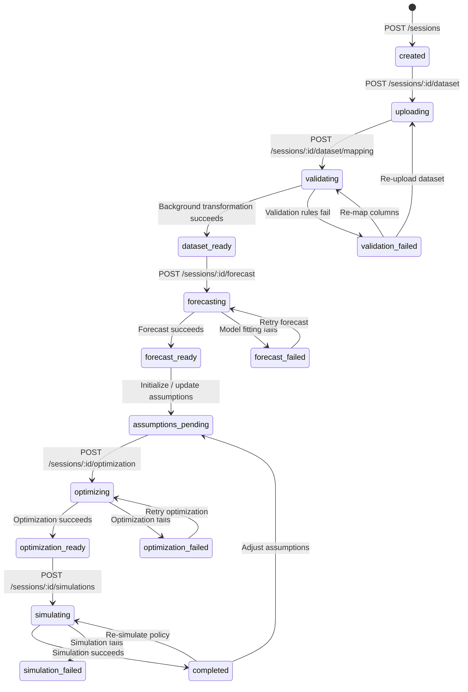

# StockPilot AI API Specification

Base HTTP API Path: `/api/v1`

StockPilot AI exposes an Express.js JSON REST API for user session management, dataset processing, job orchestration, and inventory decision support. Internal statistical modeling and discrete-event simulations are executed by a private FastAPI microservice listening on port 8000.

---

## 1. Response Envelopes and Conventions

### 1.1 Success Envelope
All successful API responses return an HTTP `200 OK` (or `201 Created` for resource instantiation) wrapped in a standardized JSON payload:
```json
{
  "data": { ... },
  "meta": {
    "page": 1,
    "limit": 20,
    "total": 42
  }
}
```
`meta` is optional and present on paginated queries or batch listings.

### 1.2 Error Envelope
When a request fails, the API responds with an appropriate HTTP error status code and a structured error payload:
```json
{
  "error": {
    "code": "DATASET_VALIDATION_FAILED",
    "message": "Mapped columns not found in header.",
    "details": {
      "missing": ["quantity"]
    },
    "requestId": "req_01jcbxyz7890"
  }
}
```

### 1.3 Standard HTTP Status Codes
- `200 OK`: Request succeeded.
- `201 Created`: Resource successfully created.
- `400 BAD_REQUEST`: Request validation failed (Zod schema rejection on params, query, or body).
- `401 UNAUTHORIZED`: Missing, expired, or invalid Firebase Bearer token.
- `404 NOT_FOUND`: Resource does not exist, or ownership check failed (never returns 403 to prevent resource probing).
- `409 CONFLICT`: Invalid state machine transition or active conflicting background job in progress.
- `422 UNPROCESSABLE_ENTITY`: Syntactically valid request violates business or domain logic.
- `429 RATE_LIMITED`: Rate limit exceeded. Contains standard `Retry-After` header.
- `500 INTERNAL_ERROR`: Unexpected internal server error.
- `502 UPSTREAM_STATS_ERROR`: Failure communicating with Python stats service or LLM provider.
- `503 SERVICE_UNAVAILABLE`: Configured service or external provider temporarily offline.

---

## 2. Session Lifecycle and State Machine

Session progression is strictly governed by `server/src/services/stateMachine.js`.

### 2.1 State Transition Graph


### 2.2 Allowed Transitions Matrix (`ALLOWED_TRANSITIONS`)

| Current Status | Allowed Target Statuses |
| :--- | :--- |
| `created` | `uploading` |
| `uploading` | `uploading`, `validating` |
| `validating` | `uploading`, `validating`, `dataset_ready`, `validation_failed` |
| `validation_failed` | `uploading`, `validating` |
| `dataset_ready` | `forecasting` |
| `forecasting` | `forecast_ready`, `forecast_failed`, `dataset_ready` |
| `forecast_failed` | `forecasting` |
| `forecast_ready` | `assumptions_pending` |
| `assumptions_pending` | `assumptions_pending`, `optimizing` |
| `optimizing` | `optimization_ready`, `optimization_failed`, `assumptions_pending` |
| `optimization_failed` | `assumptions_pending`, `optimizing` |
| `optimization_ready` | `assumptions_pending`, `simulating` |
| `simulating` | `completed`, `simulation_failed`, `optimization_ready` |
| `simulation_failed` | `simulating`, `assumptions_pending` |
| `completed` | `assumptions_pending`, `simulating` |
| `cancelled` | *(Terminal state)* |

### 2.3 Action Permissions Matrix (`ACTION_ALLOWED_FROM`)

| Action Name | Permitted From Session Statuses |
| :--- | :--- |
| `upload` | `created`, `uploading`, `validating`, `validation_failed` |
| `mapping` | `uploading`, `validating`, `validation_failed` |
| `confirmDataset`| `validating` |
| `forecast` | `dataset_ready`, `forecast_failed` |
| `assumptions` | `forecast_ready`, `assumptions_pending`, `optimization_failed`, `optimization_ready`, `simulation_failed`, `completed` |
| `optimize` | `assumptions_pending`, `optimization_failed` |
| `simulate` | `optimization_ready`, `simulation_failed`, `completed` |
| `portfolio` | `completed`, `simulation_failed` |
| `aiEligible` | `forecast_ready`, `assumptions_pending`, `optimizing`, `optimization_ready`, `optimization_failed`, `simulating`, `simulation_failed`, `completed` |

---

## 3. Express REST API Endpoints (`/api/v1`)

### 3.1 Sessions (`/sessions`)
- **`GET /sessions`**
  - **Preconditions**: Authenticated user.
  - **Query**: `limit` (int, default 20, max 100), `cursor` (string, optional Mongo ObjectId), `status` (string, optional).
  - **Response 200**: `{ "data": [Session], "meta": { "hasMore": boolean, "nextCursor": string | null, "total": number } }`.
- **`POST /sessions`**
  - **Body**: `{ "name"?: string, "notes"?: string }`.
  - **Response 201**: `{ "data": Session }`. Initial status is `"created"`.
- **`GET /sessions/:sessionId`**
  - **Preconditions**: Session exists and `session.userId === req.userId`.
  - **Response 200**: `{ "data": Session }`.
  - **Response 404**: `NOT_FOUND` if session does not exist or user mismatch.
- **`PATCH /sessions/:sessionId`**
  - **Body**: `{ "name"?: string, "notes"?: string, "archived"?: boolean }`.
  - **Response 200**: `{ "data": Session }`.
- **`DELETE /sessions/:sessionId`**
  - **Preconditions**: No active running background jobs (`409 CONFLICT` if active).
  - **Behavior**: Cascading deletion across 10 Mongo collections, local storage files (`datasets/${userId}/${sessionId}/`), and Qdrant vector collections.
  - **Response 200**: `{ "data": { "deleted": true } }`.

### 3.2 Datasets & Preprocessing (`/sessions/:sessionId/dataset`)
- **`POST /sessions/:sessionId/dataset`**
  - **Preconditions**: State allows `upload`.
  - **Body**: `multipart/form-data` with binary field `file` (`.csv`, `.tsv`, `.txt`).
  - **Behavior**: Writes raw file to storage; transitions session to `"uploading"`.
  - **Response 200**: `{ "data": { "datasetId": string, "detectedColumns": string[], "sampleRows": object[] } }`.
- **`POST /sessions/:sessionId/dataset/mapping`**
  - **Preconditions**: State allows `mapping`.
  - **Body**:
    ```json
    {
      "skuColumn": "StockCode",
      "dateColumn": "InvoiceDate",
      "quantityColumn": "Quantity",
      "dateFormat": "YYYY-MM-DD",
      "negativeQuantityPolicy": "drop"
    }
    ```
  - **Behavior**: Enqueues `"validation"` background job.
  - **Response 202**: `{ "data": { "jobId": string, "status": "queued" } }`.
- **`POST /sessions/:sessionId/dataset/confirm`**
  - **Preconditions**: State allows `confirmDataset` (`validating` status).
  - **Behavior**: Enqueues `"transformation"` background job (365-day windowing, zero imputation, dense series creation).
  - **Response 202**: `{ "data": { "jobId": string, "status": "queued" } }`.
- **`GET /sessions/:sessionId/dataset`**
  - **Response 200**: `{ "data": Dataset }` including `validationSummary`, `transformationConfig`, and row counts.
- **`GET /sessions/:sessionId/dataset/series`**
  - **Query**: `page` (int, default 1), `limit` (int, default 20), `demandClass` (optional string).
  - **Response 200**: `{ "data": [ProcessedSeries], "meta": { "page": number, "total": number } }`.
- **`GET /sessions/:sessionId/dataset/series/:sku`**
  - **Response 200**: `{ "data": ProcessedSeries }` containing full historical daily points `(date, quantity)`.

### 3.3 Statistical Forecasting (`/sessions/:sessionId/forecast`)
- **`POST /sessions/:sessionId/forecast`**
  - **Preconditions**: State allows `forecast` (`dataset_ready` or `forecast_failed`).
  - **Body**: `{ "seed"?: number, "horizon"?: number, "minHistory"?: number }`. Defaults: seed=42, horizon=28, minHistory=56.
  - **Behavior**: Enqueues `"forecast"` background job; calls Python `/evaluate` and `/forecast`.
  - **Response 202**: `{ "data": { "jobId": string, "status": "queued" } }`.
- **`GET /sessions/:sessionId/forecast`**
  - **Response 200**: `{ "data": ForecastRun }` or `{ "data": null }` if not yet executed. Contains overall `maseImprovement`, `wape`, model aggregates, and runtime metadata.
- **`GET /sessions/:sessionId/forecast/series/:sku`**
  - **Response 200**: `{ "data": SkuForecast }` including chosen model, point forecast, intervals (`p10, p50, p90`), residual blocks, and Syntetos-Boylan demand classification.

### 3.4 Operational Assumptions (`/sessions/:sessionId/assumptions`)
- **`GET /sessions/:sessionId/assumptions`**
  - **Response 200**: `{ "data": AssumptionsSet }` with `defaults` and SKU-specific `overrides`.
- **`PUT /sessions/:sessionId/assumptions`**
  - **Preconditions**: State allows `assumptions`.
  - **Body**:
    ```json
    {
      "defaults": {
        "holdingRate": 0.20,
        "orderCost": 100.0,
        "shortageCost": 50.0,
        "leadTimeMean": 7.0,
        "leadTimeStd": 1.5,
        "targetServiceLevel": 0.95
      },
      "overrides": {
        "SKU_1": { "unitCost": 45.0, "moq": 20, "packSize": 5 }
      }
    }
    ```
  - **Response 200**: `{ "data": AssumptionsSet }`. Transitions session to `"assumptions_pending"`.

### 3.5 Inventory Optimization (`/sessions/:sessionId/optimization`)
- **`POST /sessions/:sessionId/optimization`**
  - **Preconditions**: State allows `optimize` (`assumptions_pending` or `optimization_failed`).
  - **Behavior**: Enqueues `"optimization"` job; calls Python `/optimize`.
  - **Response 202**: `{ "data": { "jobId": string, "status": "queued" } }`.
- **`GET /sessions/:sessionId/optimization`**
  - **Response 200**: `{ "data": OptimizationRun }` containing recommended $(s, Q)$ policies per SKU.
- **`GET /sessions/:sessionId/optimization/series/:sku`**
  - **Response 200**: `{ "data": SkuOptimization }` with $s_{\text{det}}, s_{\text{emp}}, s_{\text{quant}}, Q$, lead-time demand stats, and skewness warnings.

### 3.6 Monte Carlo Simulation (`/sessions/:sessionId/simulations`)
- **`POST /sessions/:sessionId/simulations`**
  - **Preconditions**: State allows `simulate` (`optimization_ready`, `simulation_failed`, `completed`).
  - **Body**: `{ "nScenarios"?: number, "horizonDays"?: number, "seed"?: number }`. Defaults: nScenarios=500, horizonDays=90.
  - **Response 202**: `{ "data": { "jobId": string, "status": "queued" } }`.
- **`GET /sessions/:sessionId/simulations`**
  - **Response 200**: `{ "data": SimulationRun }` with comparative metrics for deterministic, empirical, and quantile policies.
- **`GET /sessions/:sessionId/simulations/series/:sku`**
  - **Response 200**: `{ "data": SkuSimulation }` with fill rate, CSL, stockout rates, cost breakdowns, and service-level sweep curves.

### 3.7 Historical Holdout Replay (`/sessions/:sessionId/replay`)
- **`POST /sessions/:sessionId/replay`**
  - **Body**: `{ "holdoutDays"?: number }`. Default: 28 days.
  - **Response 202**: `{ "data": { "jobId": string, "status": "queued" } }`.
- **`GET /sessions/:sessionId/replay`**
  - **Response 200**: `{ "data": ReplayRun }` comparing simulated policy performance against actual unobserved demand.

### 3.8 Portfolio MILP Optimization (`/sessions/:sessionId/portfolio`)
- **`POST /sessions/:sessionId/portfolio`**
  - **Preconditions**: State allows `portfolio` (`completed` or `simulation_failed`).
  - **Body**: `{ "budget"?: number, "capacity"?: number }`.
  - **Behavior**: Calls Python `/portfolio` executing SciPy MILP solver across service-level sweep points.
  - **Response 200**: `{ "data": PortfolioResponse }` including `exact_plan`, `greedy_plan`, `optimality_gap_pct`, and `budget_shadow_price`.
- **`GET /sessions/:sessionId/portfolio`**
  - **Response 200**: `{ "data": PortfolioResponse }`.

### 3.9 Background Jobs (`/jobs`)
- **`GET /jobs/:jobId`**
  - **Response 200**: `{ "data": { "jobId": string, "stage": string, "status": "queued" | "running" | "succeeded" | "failed" | "cancelled", "progress": number, "error": object | null } }`.
- **`POST /jobs/:jobId/cancel`**
  - **Behavior**: Aborts running job via `AbortController`; rolls back session status per `STATUS_AFTER_CANCEL`.
  - **Response 200**: `{ "data": { "cancelled": true } }`.

### 3.10 AI Decision Support (`/sessions/:sessionId/ai`)
- **`POST /sessions/:sessionId/ai/chat`**
  - **Preconditions**: State in `aiEligible`.
  - **Body**: `{ "message": string }`.
  - **Behavior**: Streams response chunks using SSE (`text/event-stream`); executes read-only tools against stored session data; grounds numerical outputs against `EvidenceLedger`.
- **`GET /sessions/:sessionId/ai/history`**
  - **Response 200**: `{ "data": [ChatMessage] }`.
- **`GET /sessions/:sessionId/ai/evidence/:evidenceId`**
  - **Response 200**: `{ "data": EvidenceEntry }` inspecting specific ledger entries ($E_0, E_1, \dots$).

---

## 4. Node-to-Python Microservice Endpoints (Port 8000)

All private microservice calls require header `X-Service-Key: <STATS_SERVICE_KEY>` and `X-Request-Id: <requestId>`. Payloads are strictly validated by Zod on Node.js and Pydantic on Python. Payloads are exchanged in `snake_case`.

### 4.1 `/forecast` (Point and Interval Generation)
- **Method**: `POST`
- **Request Model**: `ForecastRequest`
  | Field | Type | Unit | Constraints / Description |
  | :--- | :--- | :--- | :--- |
  | `series` | `list[SkuSeries]` | - | Non-empty list of unique SKU series |
  | `series[].sku_id` | `string` | - | 1-64 characters |
  | `series[].start_date`| `date` | `YYYY-MM-DD` | Calendar date of first observation |
  | `series[].values` | `list[float]` | Units/day | Non-negative demand values ($N \ge 28$) |
  | `params.horizon` | `int` | Days | Range: $[7, 56]$, default: 28 |
  | `params.season_length` | `int` | Days | Range: $[2, 30]$, default: 7 |
  | `params.min_history` | `int` | Days | Range: $[28, 365]$, default: 56 |
  | `params.block_size` | `int` | Days | Default: 7 |
  | `params.origin_step` | `int` | Days | Default: 7 |
  | `params.n_bootstrap`| `int` | Paths | Range: $[100, 2000]$, default: 500 |
  | `params.seed` | `int` | - | RNG base seed, default: 42 |
- **Response Model**: `ForecastResponse`
  Contains `run_meta`, and `forecasts: list[SkuForecast]`. Each SKU forecast returns:
  `autoets_mean`, `seasonal_naive_mean`, `naive_mean`, `global_lgbm_mean`, `p10`, `p50`, `p90`, `residual_blocks` (shape $B \times 7$), `residual_std`, `demand_class`, `adi`, `cv2`, `chosen_model`, and `mase_improvement`.

### 4.2 `/evaluate` (8-Origin Rolling Backtesting)
- **Method**: `POST`
- **Request Model**: `EvaluateRequest` (identical payload structure to `ForecastRequest`).
- **Response Model**: `EvaluateResponse`
  Contains `evaluations: list[SkuEvaluation]`, each providing out-of-sample metrics per model candidate:
  `mae`, `rmse`, `wape`, `mase` (scaled by in-sample seasonal diffs), `pinball_loss`, `coverage`, and `baseline_improvement`. Includes portfolio-level `aggregate` metrics.

### 4.3 `/optimize` (Policy Calculation)
- **Method**: `POST`
- **Request Model**: `OptimizeRequest`
  | Field | Type | Unit | Constraints / Description |
  | :--- | :--- | :--- | :--- |
  | `skus` | `list[OptimizeSkuInput]` | - | Non-empty list of SKUs with forecasts |
  | `skus[].forecast_mean` | `list[float]` | Units/day | Non-negative mean forecast |
  | `skus[].residual_blocks`| `list[list[float]]` | Units/day | Array shape $(B, 7)$ with $B \ge 8$ |
  | `skus[].residual_std` | `float` | Units/day | Standard deviation of residuals |
  | `assumptions` | `dict[str, SkuAssumptions]` | - | Keyed by `sku_id` |
  | `assumptions[].unit_cost` | `float` | ₹/unit | $> 0$ |
  | `assumptions[].holding_rate` | `float` | 1/year | $> 0$ (e.g. 0.20 = 20%/year) |
  | `assumptions[].order_cost` | `float` | ₹/order | $> 0$ |
  | `assumptions[].lead_time_mean`| `float` | Days | $\ge 1.0$ |
  | `assumptions[].lead_time_std` | `float` | Days | $\ge 0.0$ |
  | `assumptions[].target_service_level`| `float` | $[0, 1]$ | Range: $(0.5, 0.999)$ |
  | `assumptions[].moq` | `int` | Units | $\ge 1$, default: 1 |
  | `assumptions[].pack_size` | `int` | Units | $\ge 1$, default: 1 |
- **Response Model**: `OptimizeResponse`
  Returns `optimizations: list[SkuOptimization]`:
  `eoq`, `rop_det`, `rop_emp`, `rop_quant`, `safety_stock_det`, `safety_stock_emp`, `safety_stock_quant`, `lead_time_demand_stats` (`mean`, `std`, `p10`, `p50`, `p90`, `skewness`), and warnings.

### 4.4 `/simulate` (Monte Carlo Simulation & Service-Level Sweeps)
- **Method**: `POST`
- **Request Model**: `SimulateRequest`
  | Field | Type | Unit | Constraints / Description |
  | :--- | :--- | :--- | :--- |
  | `skus` | `list[SimulateSkuInput]` | - | SKUs with policy inputs $(s_{\text{det}}, s_{\text{emp}}, s_{\text{quant}}, Q)$ |
  | `params.n_scenarios` | `int` | Scenarios | Range: $[100, 2000]$, default: 500 |
  | `params.horizon_days` | `int` | Days | Range: $[14, 180]$, default: 90 |
  | `assumptions` | `dict[str, SkuAssumptions]` | - | Cost and lead-time assumptions |
- **Response Model**: `SimulateResponse`
  Returns comparative policy performance (`deterministic`, `uncertainty_aware`, `quantile`):
  `service_level_achieved`, `cycle_service_level`, `stockout_day_rate`, `total_cost_mean`, `ordering_cost_mean`, `holding_cost_mean`, `shortage_cost_mean`, `avg_inventory_mean`, and `sweep` (10 discrete points for $\alpha \in [0.80, 0.98]$).

### 4.5 `/replay` (Historical Holdout Replay)
- **Method**: `POST`
- **Request Model**: `ReplayRequest`
  | Field | Type | Unit | Constraints / Description |
  | :--- | :--- | :--- | :--- |
  | `series` | `list[SkuSeries]` | - | Dense daily history |
  | `params.holdout_days` | `int` | Days | Default: 28 |
  | `assumptions` | `dict[str, SkuAssumptions]` | - | Cost and lead-time assumptions |
- **Response Model**: `ReplayResponse`
  Returns `replays: list[SkuReplay]`:
  `actual_demand_sum`, `actual_stockout_days`, `actual_lost_units`, `actual_service_level`, `actual_total_cost` evaluated across policies on the holdout period.

### 4.6 `/portfolio` (Exact MILP Capital Allocation)
- **Method**: `POST`
- **Request Model**: `PortfolioRequest`
  | Field | Type | Unit | Constraints / Description |
  | :--- | :--- | :--- | :--- |
  | `skus` | `list[PortfolioSkuInput]` | - | SKUs with precomputed service-level curves |
  | `budget` | `float` | ₹ | Optional working capital ceiling |
  | `capacity` | `float` | Units | Optional warehouse unit capacity |
- **Response Model**: `PortfolioResponse`
  | Field | Type | Description |
  | :--- | :--- | :--- |
  | `exact_plan` | `PortfolioPlanSummary` | Optimal allocation under MILP |
  | `greedy_plan` | `PortfolioPlanSummary` | Heuristic marginal allocation |
  | `optimality_gap_pct` | `float` | $(C_{\text{greedy}} - C_{\text{exact}}) / C_{\text{exact}} \times 100$ |
  | `budget_shadow_price` | `float` | Marginal cost change per ₹1 budget perturbation |
  | `binding_constraints` | `list[string]` | Active constraints (`"budget"`, `"capacity"`) |
  | `minimum_feasible_budget` | `float` | Minimum working capital required to satisfy lowest grid points |
