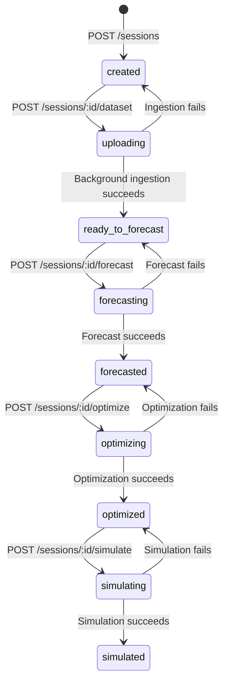

# StockPilot AI API Reference

Base API Path: `/api/v1`

All requests expecting or returning JSON use `Content-Type: application/json`. File uploads use `multipart/form-data`.

---

## 1. Response Envelopes & Conventions

### 1.1 Success Envelope

```json
{
  "data": { ... },
  "meta": {
    "page": 1,
    "limit": 20,
    "total": 42
  }
}
```

### 1.2 Error Envelope

```json
{
  "error": {
    "code": "NOT_FOUND",
    "message": "Resource was not found.",
    "details": null,
    "requestId": "req_01hkabcde12345"
  }
}
```

### 1.3 Standard HTTP Status Codes

- `200 OK`: Request succeeded.
- `201 Created`: Resource successfully created.
- `400 BAD_REQUEST`: Request validation failed (invalid body, query, or params).
- `401 UNAUTHORIZED`: Missing or invalid Firebase Bearer token.
- `404 NOT_FOUND`: Resource does not exist or user is not authorized to access it (ownership check failed).
- `409 CONFLICT`: Invalid state transition or active running job conflict.
- `422 UNPROCESSABLE_ENTITY`: Domain logic constraint violation.
- `429 RATE_LIMITED`: Rate limit exceeded (`Retry-After` header included).
- `500 INTERNAL_ERROR`: Unexpected internal server error.
- `502 UPSTREAM_SERVICE_ERROR`: Failure communicating with Python stats service, LLM provider, or Qdrant.
- `503 SERVICE_UNAVAILABLE`: Configured service or AI provider unavailable.

---

## 2. Session Lifecycle & State Transitions

Analysis sessions follow a strictly validated state machine defined by `ALLOWED_TRANSITIONS`:



### State Machine Transition Rules:

| From State          | Allowed Target States                                | Triggering Operation                       |
| :------------------ | :--------------------------------------------------- | :----------------------------------------- |
| `created`           | `uploading`, `archived`                              | Dataset upload initiated                   |
| `uploading`         | `ready_to_forecast`, `created`, `archived`           | Ingestion job completion or failure        |
| `ready_to_forecast` | `forecasting`, `uploading`, `archived`               | Forecast job submitted                     |
| `forecasting`       | `forecasted`, `ready_to_forecast`, `archived`        | Forecast job completion or failure         |
| `forecasted`        | `optimizing`, `forecasting`, `uploading`, `archived` | Policy optimization submitted              |
| `optimizing`        | `optimized`, `forecasted`, `archived`                | Optimization job completion or failure     |
| `optimized`         | `simulating`, `optimizing`, `archived`               | Monte Carlo simulation submitted           |
| `simulated`         | `simulating`, `optimizing`, `archived`               | Re-simulation or re-optimization           |
| Any non-terminal    | `archived`                                           | `PATCH /sessions/:id` (`archived: true`)   |
| Any                 | `(deleted)`                                          | `DELETE /sessions/:id` (permanent cascade) |

---

## 3. Endpoints Directory

### 3.1 Sessions

- `GET /sessions`: List user's sessions.
  - Query: `page` (default 1), `limit` (default 20, max 100), `archived` (`true` | `false`).
- `POST /sessions`: Create a new session.
  - Body: `{ "name": "Q4 Inventory Plan", "description": "Optional details" }`.
- `GET /sessions/:sessionId`: Get session details.
- `PATCH /sessions/:sessionId`: Update session metadata or archive status.
  - Body: `{ "name"?: string, "description"?: string, "archived"?: boolean }`.
- `DELETE /sessions/:sessionId`: Permanently delete a session and all its associated artifacts, vectors, storage files, and Mongo collections.

### 3.2 Datasets & Series

- `POST /sessions/:sessionId/dataset`: Upload CSV/Excel dataset file (`multipart/form-data` with field `file`).
- `GET /sessions/:sessionId/dataset`: Get dataset ingestion status, schema, and validation summary.
- `GET /sessions/:sessionId/dataset/series`: Get paginated processed time series with aggregated metrics.
- `GET /sessions/:sessionId/dataset/series/:sku`: Get detailed daily demand history for a specific SKU.

### 3.3 Forecasts

- `POST /sessions/:sessionId/forecast`: Trigger multi-model statistical forecasting job.
  - Body: `{ "horizon_days"?: number }` (default: 30).
- `GET /sessions/:sessionId/forecast`: Get current active forecast run, including model selection, WAPE, RMSE, and aggregate metrics.
- `GET /sessions/:sessionId/forecast/series/:sku`: Get SKU-level forecast with confidence intervals and residual blocks.

### 3.4 Assumption Sets & Optimization

- `POST /sessions/:sessionId/assumptions`: Create or update operational assumptions.
  - Body: `{ "holding_rate_annual": 0.20, "order_cost": 50, "service_level": 0.95, "lead_time_days": 7, "unit_costs": { "SKU_A": 15.0 } }`.
- `GET /sessions/:sessionId/assumptions`: Get active assumption set for the session.
- `POST /sessions/:sessionId/optimize`: Run inventory policy optimization (EOQ, Safety Stock, Reorder Point).
- `GET /sessions/:sessionId/optimization`: Get current active inventory policy recommendations and aggregate metrics.
- `GET /sessions/:sessionId/optimization/skus/:sku`: Get SKU-specific policy parameters ($Q^*$, $s$, $SS$).

### 3.5 Simulation & What-If

- `POST /sessions/:sessionId/simulate`: Trigger Monte Carlo bootstrap simulation across lead-time demand.
  - Body: `{ "n_replications"?: number, "horizon_days"?: number }` (default: 1000 replications, 90 days).
- `GET /sessions/:sessionId/simulation`: Get Monte Carlo simulation results (fill rate distributions, stockout occurrences, holding & penalty cost distributions).
- `POST /sessions/:sessionId/what-if`: Execute on-demand scenario evaluation with modified assumptions.

### 3.6 Jobs & Async Tasks

- `GET /sessions/:sessionId/jobs`: List background jobs (ingestion, forecast, optimization, simulation).
- `GET /jobs/:jobId`: Get real-time status and logs of a specific background job.
- `POST /jobs/:jobId/cancel`: Request cancellation of a queued or running job.

### 3.7 AI Assistant & Vector Retrieval

- `GET /ai/sessions/:sessionId/status`: Check vector indexing status for the session.
- `POST /ai/sessions/:sessionId/reindex`: Trigger vector re-indexing of session summary documents in Qdrant.
- `GET /ai/sessions/:sessionId/conversations`: List chat conversations within the session.
- `POST /ai/sessions/:sessionId/conversations`: Create a new conversation thread.
- `GET /ai/conversations/:conversationId/messages`: Retrieve message history with citations.
- `POST /ai/conversations/:conversationId/messages`: Send user prompt to LangGraph agent with vector retrieval and tool calling.
